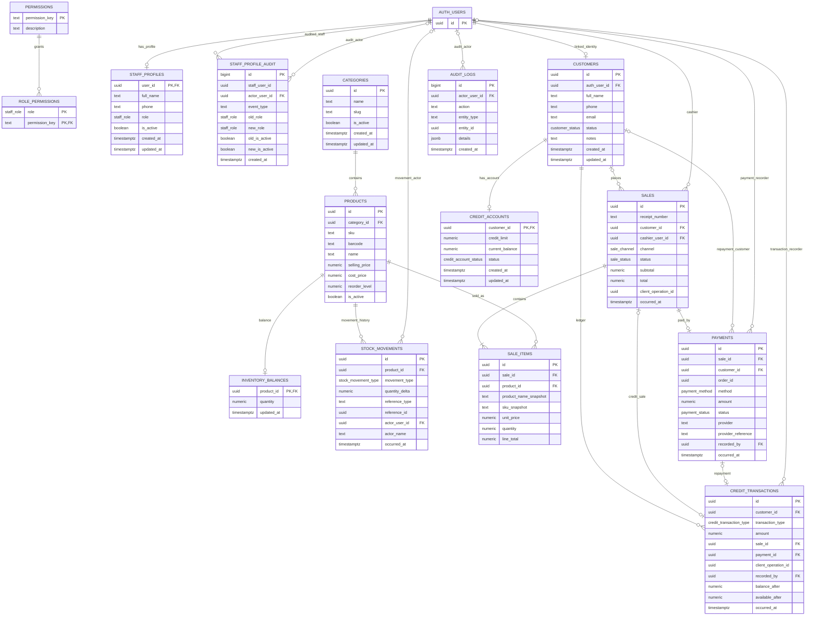

# Database ERD

This diagram is derived from the committed Supabase migrations in `supabase/migrations/`. It represents the application schema as defined in source; the configured hosted Supabase database could not be reached from the current environment for a live catalog comparison.

`auth.users` is owned by Supabase Auth and shown as an external table. `audit_logs.entity_id` and `stock_movements.reference_id` are polymorphic references and therefore do not have database foreign keys to one specific table.

## Relationship notes

- `staff_profiles.user_id` and `customers.auth_user_id` point to `auth.users`; a database trigger prevents the same identity from being assigned to both customer and staff records.
- `role_permissions` uses `(role, permission_key)` as its composite primary key. `role` references the `staff_role` enum, while `permission_key` references `permissions`.
- `inventory_balances.product_id` is both its primary key and a foreign key, giving each product at most one current balance. The migrations do not require a balance row at product creation time.
- `payments` supports both sale payments and customer credit repayments. Its `sale_id`, `customer_id`, and `order_id` combinations are constrained by a check; `order_id` has no foreign key because no `orders` table is present in these migrations.
- `credit_transactions` are append-only ledger rows. A credit sale may reference both a sale and its outstanding payment; a repayment references its payment and customer.
- `staff_profile_audit.staff_user_id` is intentionally not a foreign key, preserving history if a staff identity is deleted. `audit_logs.entity_id`, `stock_movements.reference_id`, and `payments.order_id` are not foreign keys.
