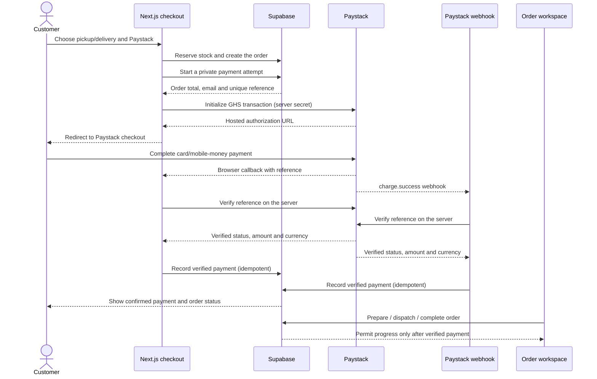

# Paystack payment flow

Grand Pa’s uses Paystack’s hosted checkout for customer pickup and delivery
orders. The backend creates the transaction and verifies it before changing an
order to paid.



## Trust boundaries

- The browser receives only Paystack’s hosted authorization URL. The Paystack
  secret and Supabase service secret stay on the server.
- A callback URL is only a notification that the customer returned. The server
  calls Paystack’s transaction verification endpoint and checks the reference,
  exact GHS amount, and currency before recording payment.
- The webhook verifies Paystack’s HMAC SHA-512 signature against the raw request
  body, then performs the same server-side transaction verification. Duplicate
  callbacks and webhook deliveries are safe to process.
- The database stores private payment attempts and exposes no direct browser
  update path for payment status. Order preparation and dispatch reject an
  unpaid Paystack order.
- Cash at pickup and cash on delivery remain available. Paystack is an optional
  prepayment choice for either fulfillment method.

## Server configuration

Set these variables in the deployment environment:

```dotenv
PAYSTACK_SECRET_KEY=sk_test_...
SUPABASE_SECRET_KEY=sb_secret_...
NEXT_PUBLIC_SITE_URL=https://your-store-domain.example
```

Use Paystack test credentials for acceptance testing and live credentials only
for production. Do not commit secret values. Online payment stays unavailable
until all three server settings are present. The public key is not needed for
the hosted redirect flow.

Register this webhook endpoint in the Paystack dashboard:

```text
https://your-store-domain.example/api/webhooks/paystack
```

The customer returns through:

```text
https://your-store-domain.example/api/payments/paystack/callback
```

## Acceptance journey

1. Configure Paystack test credentials, the Supabase server secret, and the
   public site URL.
2. Place a pickup order with Paystack; confirm Paystack shows the server
   calculated GHS total.
3. Complete the test transaction and verify the order changes to **Paid** in
   the customer history and staff order workspace.
4. Confirm an unpaid Paystack order cannot be prepared, dispatched, or completed.
5. Deliver the webhook and browser callback more than once; verify one payment
   record and one stock deduction are created.
6. Repeat for delivery after an authorized staff member has set the flat fee.
