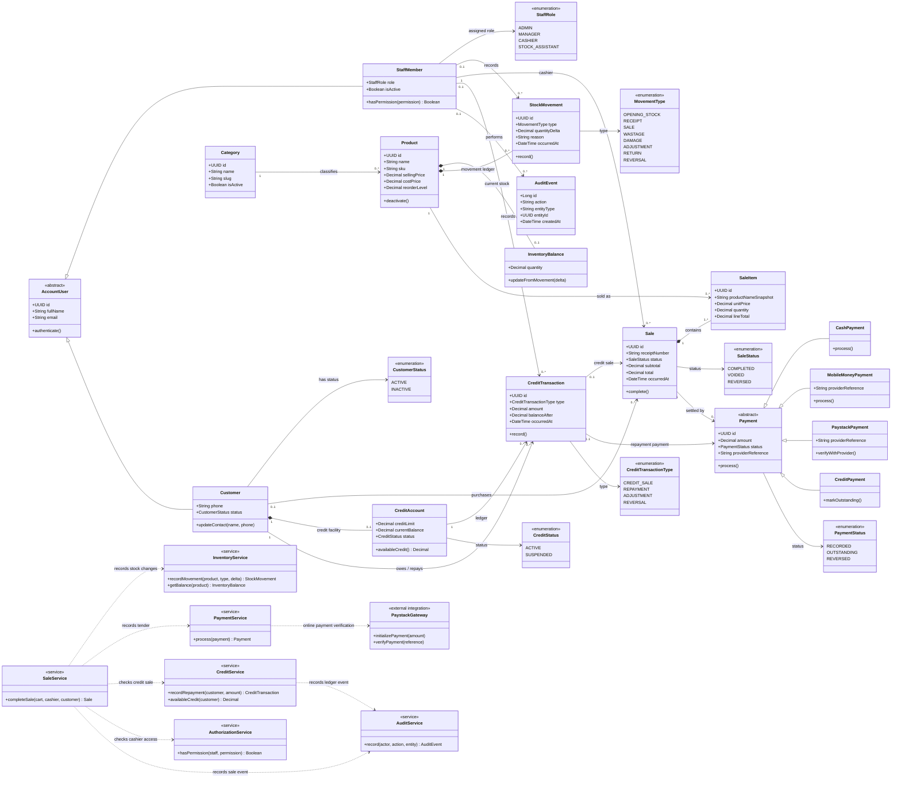

# System UML Class Diagram

This is a **domain and application class diagram** for Grand Pa’s Cold Store, based on its requirements, technical architecture, and implemented database schema. It shows inheritance, associations, composition, service responsibilities, and an external integration.

## How to read the model

- **Inheritance:** `StaffMember` and `Customer` specialize the abstract `AccountUser`. The payment method classes specialize abstract `Payment`.
- **Composition:** a `Sale` owns its `SaleItem` rows; a `CreditAccount` owns its ledger; a `Product` has its stock movement history. Diamonds indicate lifecycle/ownership relationships in the domain model.
- **Associations:** a product belongs to a category, a cashier completes sales, and sales contain product snapshots so historical receipts retain the sold name and price.
- **Services:** service classes show where transaction rules belong: sale completion coordinates payment, inventory, credit, permission, and audit work.

## Implementation mapping and scope

This is a UML **domain/application design**, not a one-to-one database diagram. The deployed schema stores staff profiles and customers in separate tables linked to Supabase `auth.users`; `AccountUser` is their shared domain abstraction. Payment methods are currently represented by one `payments` table and a `payment_method` enum, so the payment subclasses illustrate polymorphic behavior in the class model rather than separate database tables. The `PaystackGateway` class is an architecture integration point; provider verification is planned in a later project phase. The classes and relationships for current inventory, POS sales, customers, and credit reflect the committed migrations through Phase 4.
